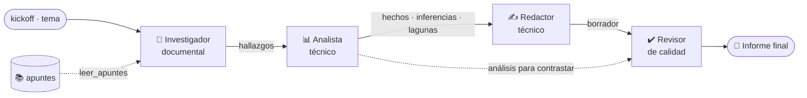

<div align="center">

# 🤝 Arquitecturas multi-agente con CrewAI

**Colaboración y especialización entre agentes de IA**

Masterclass · Módulo 5 · 27 de octubre de 2026
Por **María Isabel Durango Pérez**

[](https://www.python.org/)
[](https://docs.crewai.com/)
[](https://platform.openai.com/)
[](https://mariaisadurango.github.io/CLASE-SOBRE-ARQUITECTURAS-MULTI-AGENTE-CON-CREWAI/)

### [▶ Ver la presentación](https://mariaisadurango.github.io/CLASE-SOBRE-ARQUITECTURAS-MULTI-AGENTE-CON-CREWAI/)

</div>

---

## 📑 Contenido

- [Sobre la clase](#-sobre-la-clase)
- [Objetivos de aprendizaje](#-objetivos-de-aprendizaje)
- [Arquitectura del caso práctico](#️-arquitectura-del-caso-práctico)
- [Estructura del repositorio](#-estructura-del-repositorio)
- [Taller práctico](#️-taller-práctico)
- [Conexión con el módulo](#-conexión-con-el-módulo)
- [Fuentes](#-fuentes)

---

## 🎯 Sobre la clase

Un solo agente que investiga, analiza, redacta y revisa acaba con el contexto saturado, demasiadas herramientas y nadie que cuestione su trabajo. Esta sesión explica cómo **repartir el trabajo entre agentes especializados que se coordinan**, y cómo implementarlo con **CrewAI**.

| Bloque | Contenido |
|---|---|
| **Fundamentos** | Qué es un sistema multi-agente y cuándo compensa frente a un agente individual o un flujo determinista |
| **Patrones** | Secuencial, supervisor, jerárquico y red (peer-to-peer) |
| **CrewAI** | `Agent`, `Task`, `Crew`, `Process`, herramientas, guardrails, memoria, Crews vs Flows |
| **Caso práctico** | Un equipo de 4 agentes que redacta un informe técnico |
| **Taller** | Ejecutar la Crew en modo secuencial y jerárquico, y validar la salida |
| **Evaluación y riesgos** | Métricas reutilizadas de RAG, coste en tokens, propagación de errores, seguridad |

---

## 🧠 Objetivos de aprendizaje

Al terminar la sesión, el alumnado podrá:

- ✅ Explicar qué es una arquitectura multi-agente y en qué se diferencia de un agente individual.
- ✅ Decidir cuándo está justificado repartir una tarea entre varios agentes, y cuándo no.
- ✅ Definir agentes con rol, objetivo, herramientas y límites en CrewAI.
- ✅ Conectar tareas mediante `context` y elegir entre proceso `sequential` y `hierarchical`.
- ✅ Validar salidas con guardrails y medir el coste con `token_usage`.
- ✅ Identificar riesgos de calidad, coste y seguridad en sistemas multi-agente.

---

## 🏗️ Arquitectura del caso práctico

Cuatro agentes con una responsabilidad cada uno. Solo el investigador tiene herramienta (**principio de mínimo privilegio**): lee una base documental local con los apuntes del módulo.



| Agente | Herramientas | Recibe | Entrega |
|---|---|---|---|
| 🔎 Investigador documental | `leer_apuntes` | El tema | 6–10 hallazgos, cada uno con su archivo de origen |
| 📊 Analista técnico | — | Hallazgos | Hechos, inferencias y lagunas |
| ✍️ Redactor técnico | — | Análisis | Informe en Markdown (máx. 350 palabras) |
| ✔️ Revisor de calidad | — | Informe + análisis | Informe corregido |

---

## 📂 Estructura del repositorio

```
├── index.html                  # Presentación (GitHub Pages)
└── taller/
    ├── apuntes/                # Base documental: resúmenes de las sesiones del módulo
    │   ├── 01_rag.md
    │   ├── 02_agentes.md
    │   ├── 03_planificacion_memoria.md
    │   └── 04_multiagente.md
    ├── equipo.py               # Agentes, herramienta y tareas (compartido)
    ├── paso1_secuencial.py     # Crew con proceso secuencial
    ├── paso2_jerarquico.py     # Crew con proceso jerárquico (manager)
    ├── paso3_guardrail.py      # Validación de la salida con un guardrail
    ├── requirements.txt
    └── .env.example            # Plantilla para la clave de API
```

---

## 🛠️ Taller práctico

### Requisitos

- Python **3.10 a 3.13**
- Una clave de API de **OpenAI** (con `gpt-4o-mini`, cada ejecución cuesta céntimos)

### 1 · Preparar el entorno

<details open>
<summary><b>Windows (Git Bash)</b></summary>

```bash
cd taller
python -m venv .venv
source .venv/Scripts/activate
pip install -r requirements.txt
cp .env.example .env
```
</details>

<details>
<summary><b>Windows (PowerShell / CMD)</b></summary>

```powershell
cd taller
python -m venv .venv
.venv\Scripts\activate
pip install -r requirements.txt
copy .env.example .env
```
</details>

<details>
<summary><b>macOS / Linux</b></summary>

```bash
cd taller
python3 -m venv .venv
source .venv/bin/activate
pip install -r requirements.txt
cp .env.example .env
```
</details>

Abre el archivo `.env` y sustituye `pon-aqui-tu-clave` por tu clave de OpenAI.

> [!WARNING]
> El archivo `.env` contiene tu clave privada. Está excluido en `.gitignore`: **nunca lo subas a GitHub**.

### 2 · Ejecutar los pasos

| Paso | Comando | Qué se aprende |
|---|---|---|
| 1 | `python paso1_secuencial.py` | Las tareas se ejecutan en orden y cada una recibe el contexto de la anterior |
| 2 | `python paso2_jerarquico.py` | Un manager reparte y valida las tareas; compara tokens y tiempo con el paso 1 |
| 3 | `python paso3_guardrail.py` | Un guardrail valida el informe y obliga a rehacerlo si no cumple los requisitos |

Cada ejecución muestra la salida de cada agente, el informe final, el tiempo y el consumo de tokens.

### 3 · Reto

Modifica `equipo.py` y elige una opción:

- **a)** Cambia `TEMA_POR_DEFECTO` por otra pregunta que puedan responder los apuntes.
- **b)** Añade un quinto agente, *Traductor*, que pase el informe final a inglés.
- **c)** Quita la herramienta al investigador y observa qué ocurre con las fuentes.

### Errores frecuentes

| Error | Solución |
|---|---|
| `Falta OPENAI_API_KEY` | No existe el archivo `.env` o no tiene la clave |
| `ModuleNotFoundError: crewai` | El entorno virtual no está activado |
| Error al instalar CrewAI | Comprueba que tu versión de Python está entre 3.10 y 3.13 (`python --version`) |

---

## 🔗 Conexión con el módulo

Esta sesión cierra un recorrido que va del agente individual al equipo de agentes:

| Fecha | Sesión | Qué se reutiliza hoy |
|---|---|---|
| 15/10 | RAG avanzado | La herramienta del investigador es una forma de recuperación documental |
| 20/10 | Evaluación de RAG | *Faithfulness* y *relevancy* para evaluar el informe final |
| 21/10 | Agentes de IA | Cada agente sigue el bucle razonar-actuar-observar |
| 22/10 | Tool use | Herramientas asignadas por rol |
| 26/10 | Planificación y memoria | La planificación individual se convierte en coordinación entre agentes |
| **27/10** | **Multi-agente con CrewAI** | **Esta sesión** |

---

## 📚 Fuentes

- [CrewAI · Introducción (Crews y Flows)](https://docs.crewai.com/en/introduction)
- [CrewAI · Processes](https://docs.crewai.com/en/concepts/processes)
- [CrewAI · Hierarchical Process](https://docs.crewai.com/en/learn/hierarchical-process)
- [CrewAI · Sequential Process](https://docs.crewai.com/en/learn/sequential-process)
- [Anthropic · How we built our multi-agent research system](https://www.anthropic.com/engineering/multi-agent-research-system)

---

<div align="center">

Hecho por **María Isabel Durango Pérez** · Módulo 5 · 2026

</div>
